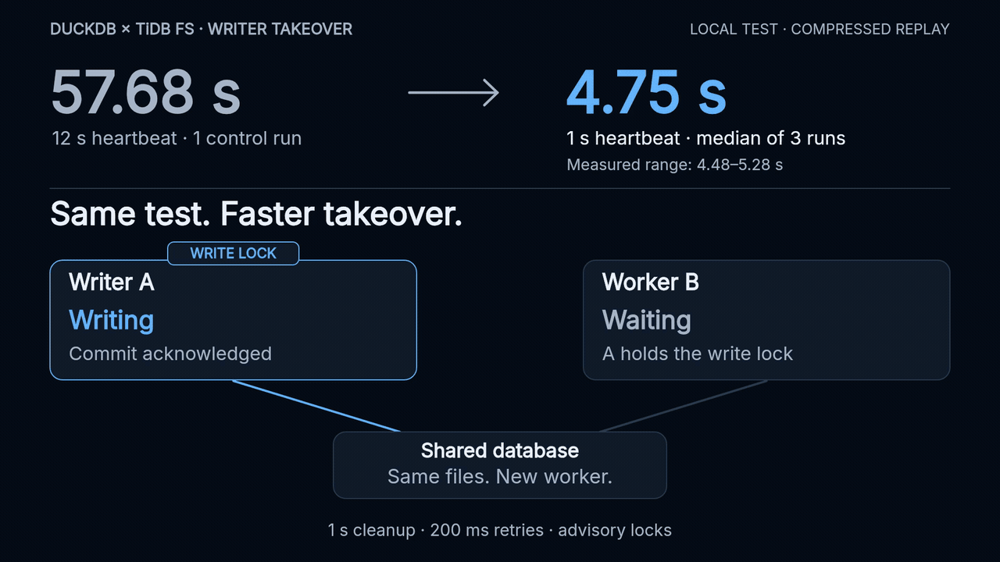

# Faster interrupted handoff — X reply

> Tested it: a 1 s heartbeat cut takeover from ~58 s to 4.75 s median (3 local runs). The old writer’s COMMIT was rejected after reconnect; all 100,002 rows verified. Still experimental, with advisory locks. Faster expiry means more heartbeats and less tolerance for stalls.

[MP4](handoff-tuning.mp4) · [Measured report and raw data](../../benchmarks/handoff-tuning-2026-10-18.md) ·
[Plugin PR](https://github.com/siddontang/duckdb-tidbfs/pull/1) ·
[Shared client PR](https://github.com/mem9-ai/drive9/pull/1039)

The silent 26-second GIF is a compressed replay, not a live screen recording.
The 12 s-heartbeat baseline is one 57.6849 s control run; 4.7481 s is the
median of three 1 s-heartbeat trials (4.4793–5.2780 s). All used 1 s server
maintenance and 200 ms ATTACH retries on local TiDB unistore + RustFS.
The representative event sequence uses the median run, which also verified
100,002 rows against an independent full-row SHA-256. This scenario rejects
the old writer in the client; arbitrary API writers remain outside the advisory
lock boundary. It is a small correctness scenario, not the 3 GiB benchmark.

`animation.cjs` reads the original JSON directly and refuses incomplete or
checksum-mismatched results. Nothing is interpolated into an invented measurement.

Build from this directory with `npm ci && sh build.sh`. Requires Node and ffmpeg.
The build emits 1920×1080/24 fps MP4, 1280×720/12 fps GIF, poster and SRT;
`qa/` contains deterministic-frame, text-bound and reading-time checks.
`TREATMENT.md` records the story and conditions; `CREDITS` records fonts and licenses.
