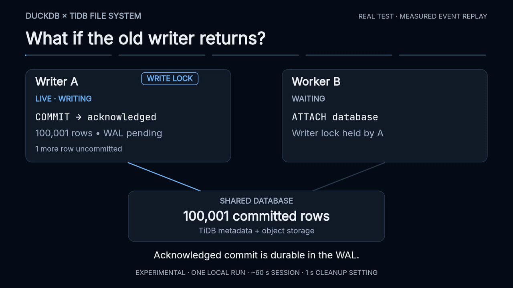

# Interrupted DuckDB handoff: disconnect, takeover, reconnect

**Follow-up:** [heartbeat tuning reduced takeover to 4.75 s median](../../benchmarks/handoff-tuning-2026-10-18.md)
in three local runs. This page and its GIF preserve the original default-heartbeat
measurement below.

**Measured on October 18, 2026 (PDT):** writer B took over **57.845 seconds**
after writer A lost connectivity. A stayed alive throughout the outage. After
both of A's network routes were restored, its attempted INSERT + COMMIT failed
with `extent session failed or expired`. B still held the database lock.



[MP4](interrupted-handoff.mp4) · [Raw results](results.json) ·
[Test harness](../../../scripts/demo_interrupted_handoff.py) ·
[Socket relay](../../../scripts/partition_proxy.py) ·
[Plugin PR](https://github.com/siddontang/duckdb-tidbfs/pull/1)

The animation is a compressed replay of measured events, not a real-time screen
recording. The timestamps and outcomes come from the linked JSON.

## What happened

| Time from disconnect | Event |
|---:|---|
| Before | A checkpoints 100,000 rows, commits one more row into a **167-byte WAL**, and leaves another row uncommitted. |
| 0.000 s | Both of A's routes—filesystem metadata and S3 object I/O—are disconnected. A remains running and answers a local `SELECT 42`. |
| 0–56.768 s | B's attempts to open for writing fail with a lock error; 54 failed attempts in total. |
| **57.845 s** | B's 55th attempt opens successfully, including WAL recovery. The successful ATTACH itself takes **35.303 ms**. |
| 58.240 s | B verifies every recovered row against the independent expected checksum: all **100,001** committed rows survived. |
| 58.468 s | After B commits its own row, A's network routes are restored. Independent probes succeed on both routes. |
| 58.478 s | A's INSERT + COMMIT is rejected in **6.081 ms**; the CLI exits with code 1 because it runs with `-bail`. |
| 59.118 s | A fresh read-only process verifies **100,002** rows. Neither A's abandoned row nor its attempted stale row exists. |

Times are from the monotonic controller clock and include local command/barrier
overhead. The takeover number measures disconnect → completion of B's successful
ATTACH. One-second retry sleeps plus worker startup/attempt time limit timing
resolution; the last failed attempt ended at 56.768 s and the successful one
started at 57.774 s. This is **one observed run**, not a latency distribution or SLA.

## Data consistency evidence

The table has an integer primary key and `payload = md5(id::VARCHAR)`. Baseline
IDs are 0–99,999. A's acknowledged WAL commit adds 100,000; B adds 100,001.
A's abandoned transaction contains 100,002 and attempts 100,003 after reconnect.

Every verification reads **all rows ordered by ID**, compares the exact count,
and hashes the canonical `id,payload\n` stream with SHA-256. Expected contents are
generated independently in Python; verification is not a metadata-only count.

| Check | Rows | SHA-256 |
|---|---:|---|
| A before disconnect; B after WAL recovery | 100,001 | `c9cefafcfd28fe3f120552a4f1e1da5fcf9408ac25b347c2a7f708a6e886fba9` |
| B before reconnect; B after rejection; fresh reader | 100,002 | `d86a3978b55958cc6671d0af8e56f0a210d8c5993afde7a6e88f7afdab6f5b80` |

An additional query confirms zero rows with IDs 100,002 or 100,003.

## Exact fault and scope

- Real DuckDB 1.4.2 and native extension, TiDB 8.5.3 **unistore**, RustFS 1.0.3,
  on one Apple M4 Mac with 24 GiB RAM. All traffic is loopback.
- Two A-specific HTTP relays forward normal metadata and S3 requests. The
  metadata relay rewrites only A's test object endpoint so both lanes cross the
  same switch. Cutting it shuts down active sockets and rejects new connections
  without returning synthetic HTTP failure responses. B connects independently.
- A is **not paused, killed, closed, or detached** to induce takeover. No session
  expiry or lock rows are modified, and no explicit stale-session cleanup API is
  called by the test. Only the disposable test's connections are affected.
- Session lifetime is the existing approximately **60 seconds**. The demo sets
  `DRIVE9_TENANT_MAINTENANCE_INTERVAL=1s`; the server default is **5 minutes**.
  Takeover depends on expiry, cleanup scheduling and retries. **57.845 seconds
  must not be presented as a production/default-configuration guarantee.**
- The test requires the experimental server to advertise `session_guard: true`.
  Nevertheless, **this particular stale COMMIT is rejected by the client**:
  the proxy trace contains no subsequent extent publication after reconnection.
  It does not independently test the server's delayed-publication race guard.
  That has a [separate regression](../../../bridge/session_guard_test.go).
- This covers a complete per-worker socket disconnection at an idle transaction
  boundary. It does not cover silent packet blackholes, asymmetric partitions,
  in-flight uncertain COMMITs, clock skew, production TiKV/object-store failover,
  or clients that bypass advisory locks. It is a small correctness scenario,
  separate from the [3.20 GiB clean-handoff benchmark](../../benchmarks/handoff-2026-10-18.md).

## Reproduce

Build the native extension as described in the repository README. Install the
test dependencies into a virtual environment (`pymysql`, `boto3`). Provide the
TiDB server binary, the pinned RustFS binary from `scripts/download_rustfs.py`,
and a filesystem server with the session guard and stale-session maintenance.

The measured engine revisions are:

- Plugin: `0270868c9c4fa8ad9820e4bbde2181bd461134a8`.
- Shared client: `153cca5271a7`, via [drive9 #1039](https://github.com/mem9-ai/drive9/pull/1039).
- Server: `1a4967b61ac8ca6105945aa5d4955d3b5265495b`, from
  [fs #241](https://github.com/tidbcloud/fs/pull/241) (**requires repository access**).

The demo and harness are public; reproducing this exact server build requires
access to that server checkout. The harness refuses a server that does not
advertise the guard. The independent conditional-read PR #238 is not the guard.
Binary and test-source SHA-256 values are in the raw JSON.

```sh
python scripts/demo_interrupted_handoff.py \
  --tidb-server /path/to/tidb-server \
  --fs-server /path/to/guarded/drive9-server \
  --fs-source /path/to/guarded/fs-checkout \
  --rustfs-server "$PWD/build/rustfs" \
  --log-dir build/interrupted-handoff-new-run
```

The harness uses disposable directories, credentials, ports and a bucket; it
stops its own processes and removes runtime storage on exit. Results and service
logs remain in the selected build directory. Do not publish unreviewed service
logs: only the structured results deliberately omit tokens, keys and endpoints.

## Rebuild the visual

With Node.js and ffmpeg installed, run `npm ci` and `sh build.sh` in this directory.
The renderer reads `results.json`; it refuses incomplete results or a checksum
mismatch. Fonts are bundled with their OFL licenses. The silent MP4 is 34 seconds,
1920×1080/24 fps; the GIF is 1280×720/12 fps. The animation uses Siddon Visual
Engineering v2 and retains the workers' identities across state changes.

## Short public reply

> Tested it: I disconnected the old writer from both metadata and object storage,
> let a new worker take over, then restored the old writer's connection.
>
> Takeover took 57.84 s in this local run with ~60 s sessions and a 1 s cleanup
> setting. The old COMMIT was rejected. All 100,002 committed rows matched the
> expected checksum; abandoned/stale rows were absent.
>
> This validates the cooperating client's failure behavior in this scenario.
> Advisory locks still aren't mandatory fencing against arbitrary writers.
