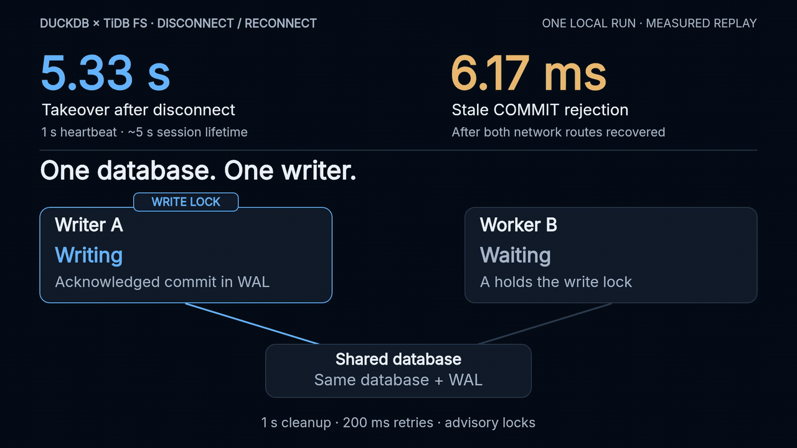

# Live disconnect / takeover / reconnect test

**Fresh run: October 18, 2026, 21:25 PDT.** The old writer stayed running while
its metadata and S3 routes were cut. A new worker took over in **5.332 seconds**.
After both routes were restored, the old writer's attempted COMMIT was rejected
in **6.171 ms**. All **100,002** final rows matched an independently generated
full-row SHA-256; abandoned and attempted stale rows were absent.



[Download GIF](reconnect-test.gif) · [MP4](reconnect-test.mp4) ·
[Original raw results](results.json) · [Test harness](../../../scripts/demo_interrupted_handoff.py) ·
[Plugin PR](https://github.com/siddontang/duckdb-tidbfs/pull/1) ·
[Shared client PR](https://github.com/mem9-ai/drive9/pull/1039)

The GIF is a **28-second compressed replay of this run's measured events**,
not a screen recording. Its numbers load directly from the original JSON.
This is one fresh run, not the earlier three-run median or a latency guarantee.

## What was actually exercised

1. Start real DuckDB 1.4.2, the native extension, TiDB 8.5.3 unistore and
   RustFS 1.0.3 on disposable loopback ports and storage.
2. Writer A checkpoints 100,000 rows, then acknowledges another row in the WAL.
   It keeps its session healthy for **16.067 s**; 15 competing writer attempts
   are excluded. A then commits two real payload changes (change, then restore),
   confirming it can still write after several session lifetimes.
3. Leave one additional row uncommitted. The measured committed WAL is
   **482 bytes**. Cut both A-specific socket relays: metadata and S3. Independent
   probes confirm both routes fail, and A still answers `SELECT 42`.
4. B repeatedly tries ATTACH through independent routes. Twenty attempts fail
   with the writer lock held; the 21st succeeds after natural expiry/cleanup.
   B verifies all recovered rows, commits its own row, and retains the lock.
5. Restore A's routes and verify both are reachable. A attempts INSERT + COMMIT
   and receives `extent session failed or expired`. Its CLI exits with code 1
   because it uses `-bail`; the process is not killed to force takeover.
6. B verifies its contents again, checkpoints and closes. A fresh read-only
   process verifies every row and separately confirms zero forbidden rows.

No session expiry, lock, or database metadata rows are edited by the harness.
No manual stale-session cleanup is invoked. All runtime storage is removed
and all test-owned child processes are stopped after the run.

## Timing and data evidence

| Measurement | This run |
|---|---:|
| Disconnect → B's successful ATTACH completes | **5.332 s** |
| Successful ATTACH alone, including WAL recovery | 40.559 ms |
| Both A routes restored, relative to disconnect | 5.870 s |
| A's attempted stale INSERT + COMMIT → rejection | **6.171 ms** |
| Final verified rows | **100,002** |
| Abandoned / attempted stale rows | **0** |

The takeover timer includes failed attempts, worker startup and retry sleeps.
The first full verification scan is subsequent to ATTACH, not included in that
timer. The controller's monotonic timestamps and all attempt boundaries are
retained in `results.json`.

Rows contain integer `id` and `payload = md5(id::VARCHAR)`. The verifier reads
every row in ID order, hashes the canonical `id,payload\n` stream, and compares
it with a separate Python-generated expected stream. It also checks the count.

| State | Rows | SHA-256 |
|---|---:|---|
| A before disconnect; B after WAL recovery | 100,001 | `c9cefafcfd28fe3f120552a4f1e1da5fcf9408ac25b347c2a7f708a6e886fba9` |
| B after its commit; B after A's rejection; fresh reader | 100,002 | `d86a3978b55958cc6671d0af8e56f0a210d8c5993afde7a6e88f7afdab6f5b80` |

## Configuration and scope

This run uses **1 s heartbeat**, about **5 s session lifetime**, **1 s server
maintenance**, and **200 ms ATTACH retry sleeps**. The default heartbeat remains
12 s. Short intervals require the generic server session guard. See
[configuration, tradeoffs and the earlier comparison](../../benchmarks/handoff-tuning-2026-10-18.md).

The environment is an Apple M4 Mac with 24 GiB RAM, macOS 27.0.1 arm64, running
all services locally. This is a small 100,002-row correctness test, separate
from the multi-GiB clean-handoff benchmark. It does not establish production
partition behavior, a fixed 5-second bound, or large-WAL recovery latency.

The old COMMIT in this scenario is rejected **by the client**. A's proxy trace
contains no subsequent extent publication after reconnect. This is not an
independent test of the server's delayed in-flight publication guard; that is
covered by the separate bridge regression. Locks remain advisory and require
cooperating clients. Arbitrary authorized writers can bypass advisory locks.

## Reproduce

Build the extension from this PR, install `pymysql` and `boto3` in a Python
virtual environment, and provide the TiDB, RustFS and guarded server binaries:

```sh
python3 scripts/demo_interrupted_handoff.py \
  --tidb-server /path/to/tidb-server \
  --fs-server /path/to/guarded/drive9-server \
  --fs-source /path/to/guarded/fs-checkout \
  --rustfs-server "$PWD/build/rustfs" \
  --heartbeat-ms 1000 --maintenance-interval 1s \
  --poll-interval 0.2 --healthy-seconds 15 \
  --log-dir build/reconnect-new-run
```

The executed checkout was `3be9e5331c80cdbe99f0cb46a209eb4b7799172b`.
The engine binary is unchanged from `4a1f685aa42e3123734dd1a639bf27bcaf915f59`;
subsequent commits added the stronger test and documentation. Shared SDK:
`67deed055d66c9cac05dbe752eeee6700559fc6c`. Server:
`1a4967b61ac8ca6105945aa5d4955d3b5265495b` from
[fs #241](https://github.com/tidbcloud/fs/pull/241), which requires repository access.
The exact server dependency is not available from the public demo alone.

The original JSON records all binary hashes. Its harness SHA-256 is
`89a45011ee8b29996bf9e22c022fc151345e7eedcd655b844d2c1a71c3148a5e`,
verified against the committed source. Runtime service logs are not published;
the structured results deliberately omit keys, tokens and endpoints.

## Rebuild the GIF

Run `npm ci && sh build.sh` in this directory with Node and ffmpeg installed.
The deterministic renderer emits the GIF, MP4, poster and captions; `qa/`
contains bounds, reading-time and shuffled-frame checks. Fonts and OFL licenses
are shared with `../interrupted-handoff/fonts/`. See `CREDITS` and `TREATMENT.md`.

## Short public reply

> Ran a fresh disconnect/reconnect test: takeover took 5.33 s with a 1 s heartbeat. After reconnect, the old writer's COMMIT was rejected in 6.17 ms. All 100,002 rows matched the expected checksum; zero stale rows. Local experiment, advisory locks.
