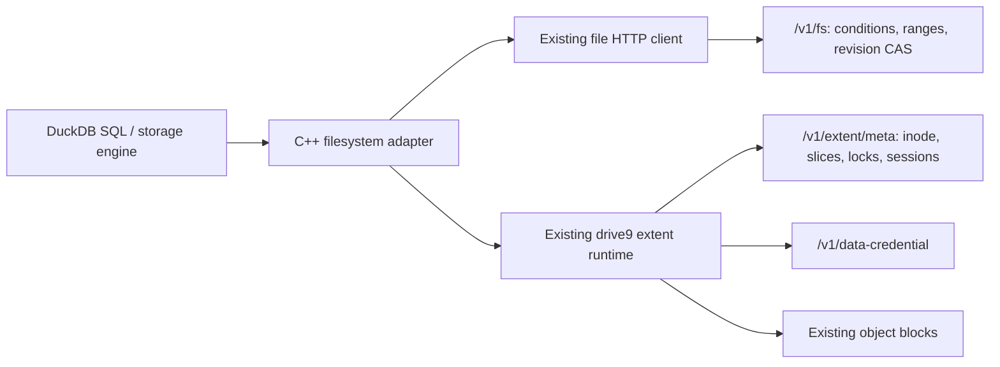

# Native DuckDB over existing extent storage

The extension implements DuckDB's C++ FileSystem interface. Its extent adapter
links `mem9-ai/drive9` at `d39a6d1b3ba1d3e23fc75b8d530259c861855702`
through `bridge/main.go`. The bridge is in-process, not a new filesystem server
or a separately deployed service. Its module pins the same JuiceFS HTTP engine
fork used by drive9. Build-time Go dependencies are recorded in `bridge/go.sum`.

## Files and requests

`tidbfs+db:///warehouse.duckdb` maps to `/warehouse.duckdb`, with the usual
`.wal` and `.tmp/` sidecars. Arbitrary base filenames are accepted. All of these
are normal extent files, visible through `/v1/fs` metadata and listing. The
server has no DuckDB filename, WAL, transaction or checkpoint logic.



`tidbfs:///` keeps the conditional-read and CAS-upload implementation for ordinary
analytical files. Existing extent-layout files automatically use the same extent
adapter. `tidbfs+db:///` explicitly selects extent creation and database locks.
It does not select a separate storage namespace.

No server flag or schema migration is needed for native mode. It needs a server
with the existing extent API and a supported data-credential backend. The
current runtime supports local file storage for tests and S3/GCS object storage.
Subtree-scoped server tokens are rejected by the existing inode API; use an
unscoped filesystem token. DuckDB secret scopes only control client routing.

## Locking, durability and failures

DuckDB's lock flags map to existing whole-file POSIX `setlk` locks with a stable
handle owner. Multiple readers can hold shared locks; a writer excludes them.
All clients writing a live database must honor these advisory locks. An ordinary
PUT or rename is not fenced by a database-specific lease. This is the existing
filesystem contract, not mandatory enforcement against arbitrary other writers.

The existing VFS performs random I/O, zero-filled holes, truncate, rename,
unlink, block uploads and slice publication. Its writeback staging is disabled.
The first adapter version syncs each write through VFS.Fsync before returning,
and maps DuckDB FileSync to that same operation. This avoids whole-database
uploads but adds synchronous flush overhead; write batching needs separate
performance work and recovery validation. The C ABI currently marshals bounded
1 MiB chunks through JSON/base64, adding copies inside the process. Object
transfers retain the runtime's existing binary protocol.

Metadata transport errors permanently fail that client session. Repeated
metadata publication attempts from the runtime are blocked after an ambiguous
response. Immutable object uploads may still use the runtime's normal retries.
The adapter also refuses I/O and renewal five seconds before its last confirmed
session deadline if no refresh succeeded. A process paused past expiry cannot
resume using an old lock. This client guard is not a new server-side fencing
contract: delayed in-flight RPCs, clock skew and server failover remain explicit
limits requiring further validation.

Existing sessions refresh approximately every 12 seconds and expire after
approximately 60 seconds. After SIGKILL, the server's existing stale-session
sweep must release locks before another process opens the database. Recovery
latency depends on that sweep; there is no fixed 30-second takeover guarantee.
After an ambiguous COMMIT, reopen and reconcile application state; either the
committed or aborted outcome may be valid. Never blindly replay the transaction.

Temporary files follow ordinary extent lifecycle. DuckDB removes its spill
directory on normal cleanup; a crashed process can leave named temporary files.
No new filename-based server garbage collector is introduced. Ordinary backup,
quota and deletion behavior is inherited from extent storage, with no parallel
set of tables to integrate.

## Build and live validation

Build with a matching DuckDB 1.4.2 CLI/SDK, C++17, Go >=1.25.1 and libcurl:

```sh
make test
python3 -m pip install pymysql
python3 scripts/test_native_live.py \
  --tidb-server /path/to/tidb-server \
  --fs-server /path/to/drive9-server \
  --fs-source /path/to/fs
```

The harness creates disposable TiDB and filesystem processes, databases, object
storage, keys and paths. It runs bridge conformance, native SQL and recovery
checks. `--fs-source` additionally runs relevant server read/extent/schema tests.
Logs are under ignored `build/native-live/`. The disposable services use UTC
and a one-second maintenance poll to bound cleanup latency; the real 60-second
session expiry is unchanged. No existing services are stopped.

Checks include DDL/DML, COMMIT/ROLLBACK, checkpoint and fresh-process reopen;
writer contention and shared readers; client SIGKILL with committed and
uncommitted WAL; missed-heartbeat resume; a dropped successful extent-write
response; remote spill and out-of-memory cleanup; normal namespace visibility;
analytical reads/writes of extent Parquet; and client/server restart recovery.
Bridge tests exercise binary data, holes, truncate/regrow, rename replacement,
unlink with open handles, cross-session locks and fail-closed deadlines.

Public GitHub CI builds a pinned public drive9 server and runs bridge conformance
plus six native compatibility cases. The full crash, missed-heartbeat and restart
suite targets current `tidbcloud/fs` and was run locally against that checkout.
That server repository is private; its newer stale-session scheduling is not
present in the public upstream server used by CI. These recovery tests remain
enabled by default in this harness; CI lists its narrower selection explicitly.

The local file backend and TiDB unistore test functional ordering and recovery.
They do not establish S3/GCS performance, TiKV power-loss durability, arbitrary
network-partition safety, or full DuckDB/POSIX compatibility. Existing ordinary
inline/object files are not automatically converted into native extent databases.
Export/import existing prototype data before using this unreleased replacement;
no file-volume tables are read, migrated or dropped at runtime.
